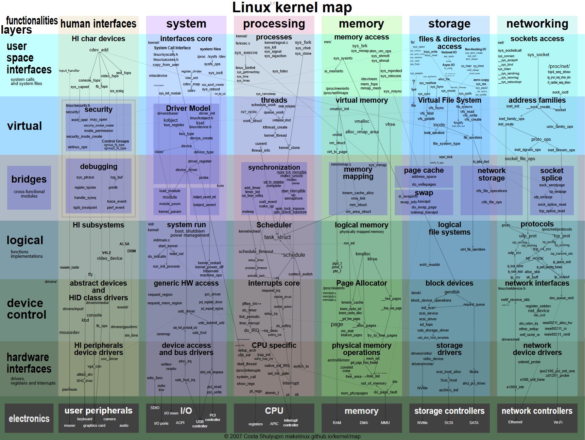

# ksrc

```
Something I hope you know before go into the coding~
First, please watch or star this repo, I'll be more happy if you follow me.
Bug report, questions and discussion are welcome, you can post an issue or pull a request.
```





## 相关站点

* <https://elixir.bootlin.com/linux/v6.6.102/source>
* <https://github.com/yifengyou/ksrc.git>
* <https://github.com/yifengyou/kdev.git>
* <https://makelinux.github.io/kernel/map/>
* <https://makelinux.github.io/kernel/diagram/>


## 笔记目录

本仓库为 GitBook 风格的内核学习笔记，总目录见 [SUMMARY.md](SUMMARY.md)，按子系统组织：

* **init**（内核启动流程）· **scheduler**（进程调度：EEVDF/PELT/负载均衡/实时）· **interrupt**（中断子系统）· **locking**（内核同步：qspinlock/seqlock/mutex/rwsem）
* **mm**（内存管理）· **RCU** · **networking**（网络子系统）· **datastructure**（内核数据结构）
* **admin-guide/LSM**（SELinux/Landlock）· **bpf** · **ras** · **virt/kvm** · **crypto/sm**（国密）· **storage/smart** · **filesystems** · **uestc-lilin**

各子系统目录下另有独立的 `SUMMARY.md`（分册目录）；`*.rst` 文件为内核官方文档镜像，供原文对照。笔记以 **Linux 6.6** 为基准版本。


